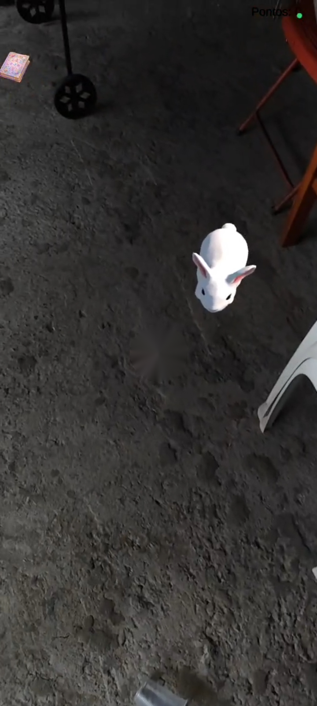
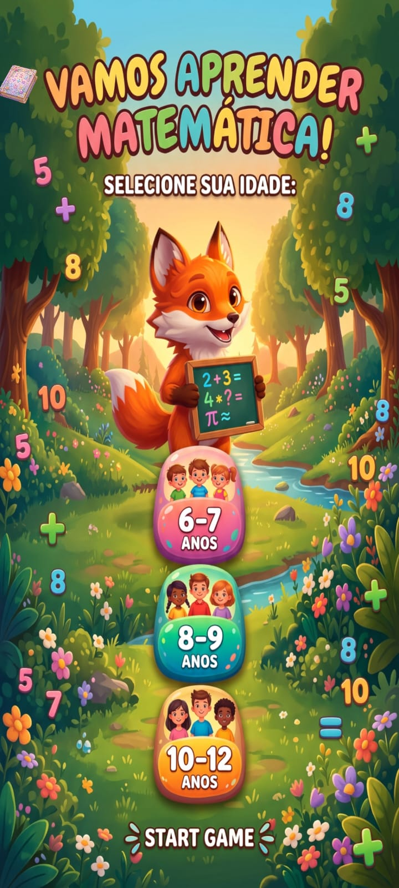
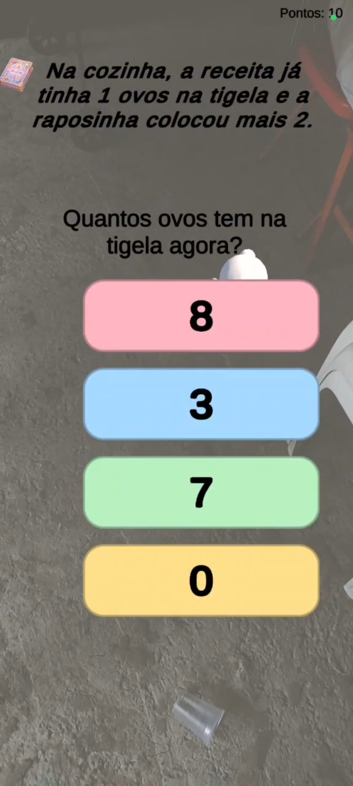
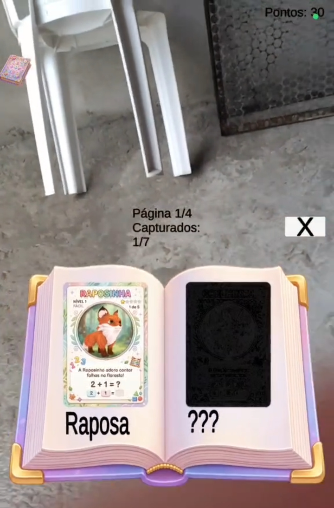
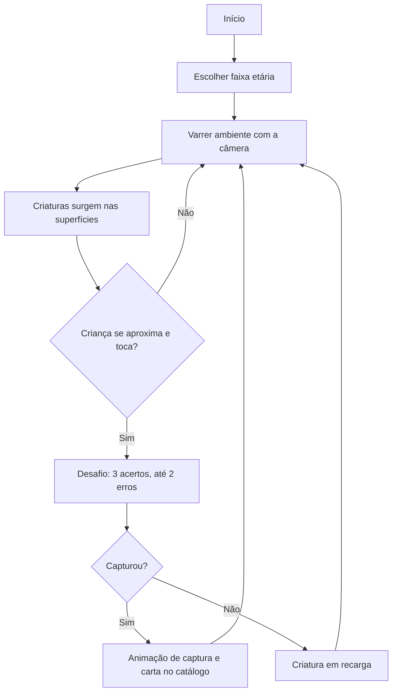
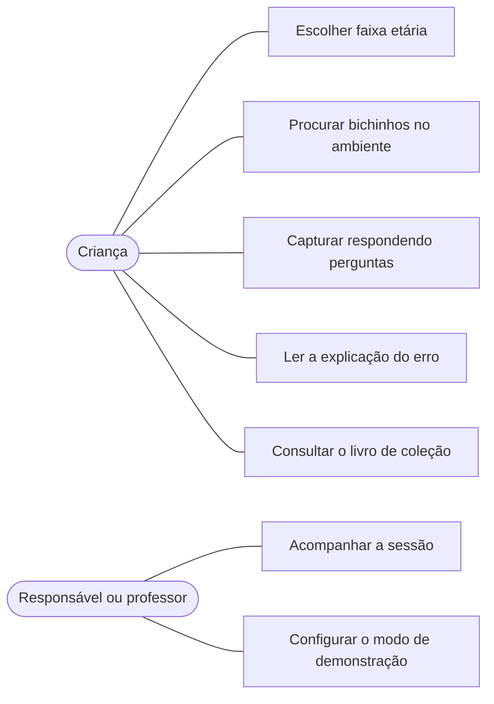
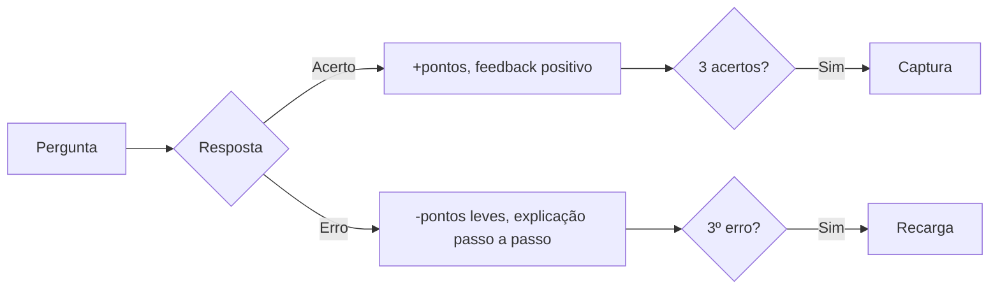

# ARMATH — Jogo de Realidade Aumentada para Matemática Básica

> **UPX: Realidade Aumentada** — Prova de conceito (PoC) de um jogo em RA para apoiar a prática de matemática básica por crianças de 6 a 12 anos.


---

## 1. Identificação do Projeto

| Item | Informação |
|---|---|
| **Projeto** | ARMATH |
| **Equipe** | Los Tralaleirinhos |
| **Instituição** | Centro Universitário Facens — Sorocaba, SP |
| **Curso** | UP801TIN3 |
| **Disciplina** | UPX — Realidade Aumentada |
| **Professor** | Daniel Ohata |
| **Semestre** | 2026.2 |

### Integrantes

| Nome | RA | Responsabilidade |
|---|---|---|
| João Vítor Goya | 235598 | Líder e gestão do projeto |
| João Pedro Medeiros | 235137 | Desenvolvimento (Unity, AR Foundation e integração) |
| Izabelly C. Fernandes | 235410 | Desenvolvimento (Unity, AR Foundation e integração) |
| Leticia D. Almeida | 234869 | Pesquisa |
| Matheus E. Oliveira | 234711 | Edição (imagens e documentação) e pesquisa |

---

## 2. Visão Geral

O projeto é um **aplicativo Android** em que criaturas virtuais ficam escondidas no ambiente físico da criança. Ela explora o espaço com a câmera do smartphone, encontra uma criatura e, para capturá-la, resolve problemas de matemática. As criaturas capturadas entram em um **catálogo em forma de livro**.

A Realidade Aumentada tem **função na mecânica do jogo**: procurar criaturas no espaço físico é o que justifica o uso da tecnologia, em vez de apenas exibir um modelo 3D.



---

## 3. Problema

O ensino de matemática básica no Brasil enfrenta desafios expressivos de aprendizagem. Dados do SAEB 2023 indicam que grande parte dos estudantes conclui etapas da educação básica nos níveis mais baixos da escala de proficiência em matemática. A forma predominantemente abstrata com que conceitos como adição e subtração costumam ser apresentados (quadro, giz e exercícios impressos repetitivos) pode dificultar o engajamento das crianças.

Esses dados servem apenas como contextualização, sem implicar relação causal direta com os métodos de ensino.

O projeto investiga se um jogo em RA, com problemas de dificuldade adaptativa, é **utilizável e engajador** e se fornece **indícios de apoio à prática** de matemática básica.

---

## 4. Objetivos

### 4.1 Objetivo Geral

Desenvolver e avaliar, como prova de conceito, um jogo de Realidade Aumentada de captura de criaturas que apoie a prática de matemática básica por crianças de 6 a 12 anos.

### 4.2 Objetivos Técnicos

- Configurar projeto Unity 6 com AR Foundation 6 e ARCore XR Plugin.
- Detectar superfícies horizontais e distribuir criaturas pelo ambiente.
- Gerar problemas de matemática com dificuldade adaptativa (5 níveis).
- Implementar regra de captura, catálogo e recarga persistente.
- Executar e verificar a aplicação em dispositivo Android real.
- Documentar instalação, execução, testes e limitações.

### 4.3 Questão de Pesquisa

> Em que medida um jogo de captura de criaturas em RA, com problemas de matemática básica de dificuldade adaptativa, é utilizável e engajador para crianças de 6 a 12 anos e fornece indícios de apoio à prática de matemática básica?

---

## 5. Público-Alvo

Crianças de **6 a 12 anos**, divididas em três faixas de dificuldade inicial: **6–7**, **8–9** e **10–12 anos**. Professores e responsáveis podem participar como informantes sobre a adequação pedagógica.

Materiais complementares (persona, jornada, TCLE, roteiros) ficam em `docs/documents/`.

---

## 6. Decisões de Projeto

- **RA pela câmera do smartphone**, sem óculos ou headset, para reduzir custo e facilitar o acesso.
- **Matemática básica** (adição, subtração, multiplicação, divisão e comparação) em situações cotidianas (rua, cafeteria, cozinha), **sem conteúdo monetário**.
- **Sem pressão de tempo e sem perda de vidas.** A ideia inicial de bolhas com contas caindo, tempo e vidas foi descartada porque a pressão temporal tende a desestimular crianças menores, pois a pressão está associada à ansiedade em matemática (ASHCRAFT, 2002). O erro gera feedback explicativo, não punição.
- **Dificuldade adaptativa** em cinco níveis, com nível inicial definido pela faixa etária.
- **Funcionamento 100% offline**, sem cadastro e sem coleta de dados pessoais.

---

## 7. Funcionalidades

| ID | Funcionalidade | Descrição | Status |
|---|---|---|---|
| RF01 | Tela inicial | Seleção de faixa etária (6–7, 8–9, 10–12), que define a dificuldade inicial | ✅ |
| RF02 | Detectar superfícies | Detecta superfícies horizontais pela câmera | ✅ |
| RF03 | Posicionar criaturas | Posiciona criaturas gradualmente, respeitando distâncias mínimas | ✅ |
| RF04 | Revelar criatura | Revela ao se aproximar e sinaliza criatura próxima | ✅ |
| RF05 | Iniciar desafio | Inicia o desafio ao toque na criatura | ✅ |
| RF06 | Gerar problemas | Adição, subtração, multiplicação, divisão e comparação, sem conteúdo monetário | ✅ |
| RF07 | Dificuldade adaptativa | Sobe após 3 acertos seguidos; desce após 2 erros seguidos | ✅ |
| RF08 | Alternativas | 4 opções (1 correta + 3 distratores) ou 3 nas comparações | ✅ |
| RF09 | Regra de captura | 3 acertos, tolerando 2 erros; o 3º erro encerra a tentativa | ✅ |
| RF10 | Feedback | Feedback imediato; no erro, explicação passo a passo | ✅ |
| RF11 | Animação de reação | Criatura reage a acertos e erros, quando há animação | ✅ |
| RF12 | Pontuação | Sobe nos acertos, desce pouco nos erros, nunca negativa | ✅ |
| RF13 | Catálogo | Livro com cartas coloridas (capturadas), silhuetas e paginação | ✅ |
| RF14 | Captura | Mensagem e animação da criatura até o catálogo | ✅ |
| RF15 | Recarga | Criatura indisponível após falha (padrão 30 min), mesmo com app fechado | ✅ |
| RF16 | Persistência | Salva progresso localmente e permite reiniciá-lo | ✅ |

**Legenda:** ✅ Implementado · 🚧 Em desenvolvimento · ⬜ Planejado · ❌ Cancelado


### Fluxo de uso

1. Escolha da faixa etária.
2. Varredura do ambiente com a câmera.
3. Surgimento gradual de criaturas.
4. Aproximação e toque.
5. Desafio de três acertos, tolerando até dois erros.
6. Captura, ou recarga em caso de falha.
7. Consulta ao catálogo.

---

## 8. Requisitos Não Funcionais

Organizados segundo a ISO/IEC 25010.

| ID | Característica | Requisito |
|---|---|---|
| RNF01 | Eficiência de desempenho | Execução fluida em Android de gama intermediária [definir meta, ex.: 30 FPS, e medir] |
| RNF02 | Compatibilidade | Android 7.0 (API 24) ou superior com ARCore. iOS não verificado |
| RNF03 | Usabilidade | Botões grandes, textos curtos, resposta por toque, sem limite de tempo |
| RNF04 | Acessibilidade de uso | Exige apenas o smartphone, sem periféricos |
| RNF05 | Segurança e privacidade | Sem dados pessoais, cadastro ou internet; armazenamento apenas local |
| RNF06 | Confiabilidade | Tolera perda de superfícies; não trava se faltar animação |
| RNF07 | Manutenibilidade | Arquitetura modular; nova criatura sem alterar código |
| RNF08 | Adequação funcional | Problemas coerentes com a faixa etária e sem conteúdo monetário |
| RNF09 | Disponibilidade | Funciona integralmente offline |

---

## 9. Tecnologias Utilizadas

Versões lidas de `ProjectSettings/ProjectVersion.txt` e `Packages/manifest.json`.

| Tecnologia | Versão | Utilização |
|---|---|---|
| Unity | 6000.0.83f1 | Motor de desenvolvimento |
| C# | compatível com Unity | Scripts da aplicação |
| AR Foundation | 6.0.8 | Camada de abstração de RA |
| Google ARCore XR Plugin | 6.0.8 | Detecção de superfícies e rastreamento no Android |
| XR Simulation | incluído no AR Foundation | Simulação de RA no Editor, para testar sem dispositivo |
| Universal Render Pipeline | 17.0.4 | Renderização |
| Input System | 1.19.0 | Entrada por toque |
| Unity UI (uGUI) / TextMeshPro | 2.0.0 | Interface e textos |
| Animator | — | Animações das criaturas |
| PlayerPrefs | — | Persistência local |
| Android SDK (API mínima 24), OpenGLES3 | — | Compilação para Android |
| Trello | — | Gerenciamento do projeto ([quadro](https://trello.com/b/zDWRdefB/up018-los-tralaleirinhos)) |
| Git / GitHub | — | Controle de versão e hospedagem |

### Identificação do aplicativo (Android)

| Item | Valor |
|---|---|
| Nome do produto (Unity) | MathAR |
| Package name | `com.armath.meuapp` |
| Versão | 0.1.0 |
| API mínima | 24 (Android 7.0) |
| Graphics API | OpenGLES3 |

> O package name `com.armath.meuapp` parece ser um nome provisório. Considere trocá-lo antes da versão final.

### Recursos de terceiros

| Recurso | Uso | Origem / Licença |
|---|---|---|
| `Assets/Rabbits` | Modelo 3D e animações do coelho (Idle, Run, Dead) | Ativo gratuito de terceiros (pacote "Rabbits"); consultar a licença na página de origem |
| `Assets/Fox` | Modelo 3D e animações da raposa | Ativo gratuito da Unity Asset Store ("Toon Fox", conforme comentário do código); consultar a licença na página de origem |
| `Assets/Quirky Series Ultimate` | Modelos 3D de animais (versão FREE: lagarto, cobra, macaco, cervo, pássaro etc.) | Unity Asset Store, licença padrão da loja (uso em projetos, sem redistribuição dos arquivos-fonte) |
| `Assets/Image` | Artes da interface (tela inicial, balão de fala, livro, cartas, adesivos "CAPTURADO!" e "Certo!") | Geradas com IA generativa (ChatGPT e Gemini, conforme nomes dos arquivos) e editadas. Conforme a política da disciplina, o uso de IA generativa está declarado aqui |

---

## 10. Hardware Utilizado

| Equipamento | Modelo | Característica relevante | Utilização |
|---|---|---|---|
| Smartphone | Xiaomi Redmi Note 13 Pro | Android com suporte ARCore | Execução e testes |
| Computador | ASUS Vivobook | Intel Core i5 de 12ª geração, 16 GB de RAM | Desenvolvimento e builds |

---

## 11. Arquitetura do Sistema

A aplicação é organizada em **quatro camadas**, implementadas como componentes C# no Unity:

| Camada | Responsabilidade |
|---|---|
| **Realidade Aumentada** | Detecção de superfícies, distribuição e revelação das criaturas, toque no mundo 3D |
| **Lógica de jogo** | Problemas, regras de captura, pontuação, dificuldade |
| **Interface** | Tela inicial, perguntas, feedback, catálogo |
| **Persistência local** | Progresso e horários de recarga |

### Fluxo central

```text
CreatureSpawner         posiciona as criaturas
      ↓
CreatureTapDetector     identifica o toque (raycast)
      ↓
CreatureCaptureController  pede problemas ao MathProblemGenerator
      ↓
GameUIManager           apresenta perguntas e recebe respostas
      ↓
CreatureInstance + CreatureCatalog   atualizam estado e catálogo
```

A interface é desacoplada da regra de captura por **callbacks**, o que permitiu mudar a regra sem reescrever a interface.

---

## 12. Funcionamento da Realidade Aumentada

### 12.1 Técnica utilizada

**Detecção de planos (Plane Detection)** com AR Foundation + ARCore. Diferente do modelo de Image Tracking, aqui não há imagem de referência: as criaturas são posicionadas em **superfícies horizontais** detectadas no ambiente.

### 12.2 Fluxo técnico

1. O aplicativo inicia a câmera e a sessão de RA.
2. O ARCore detecta superfícies horizontais (piso, mesas).
3. O `CreatureSpawner` escolhe pontos válidos, respeitando distância mínima da câmera e entre criaturas.
4. A criatura permanece oculta até a criança se aproximar (revelação por proximidade).
5. O toque é detectado por raycast físico no mundo 3D.
6. O desafio de matemática é iniciado.

### 12.3 Elementos virtuais

- Criaturas 3D animadas (7 espécies no catálogo, ex.: Raposinha).
- Indicação de criatura próxima.
- Balão de fala, feedback por imagem e explicação passo a passo.
- Catálogo em livro com cartas e silhuetas.

---

## 13. Estrutura do Projeto

Estrutura real do repositório [heyyiza/ARMATH](https://github.com/heyyiza/ARMATH):

```text
ARMATH/
│
├── Assets/
│   ├── Scenes/SampleScene.unity      # cena principal
│   ├── ARFoxPlacer.cs
│   ├── AnswerButtonStyler.cs
│   ├── GameUIManager.cs
│   ├── MathProblemGenerator.cs
│   ├── StartMenuManager.cs
│   ├── ARPlaneVisualizer.prefab      # visualização dos planos detectados
│   ├── Fox/                          # modelo e animações da raposa
│   ├── Rabbits/                      # modelo e animações do coelho
│   ├── Quirky Series Ultimate/       # pacote de modelos de animais
│   ├── Image/                        # artes da interface e cartas
│   ├── XR/                           # configurações ARCore e XR Simulation
│   ├── Settings/                     # configurações do URP
│   └── TextMesh Pro/
│
├── Packages/
├── ProjectSettings/
├── UIElementsSchema/
├── .gitattributes
├── .gitignore
└── README.md
```


---

## 14. Principais Scripts

### Presentes no repositório (`Assets/`)

| Script | Responsabilidade |
|---|---|
| `StartMenuManager.cs` | Tela inicial; define a dificuldade pela faixa etária e libera o jogo |
| `ARFoxPlacer.cs` | Posiciona a criatura (raposa) sobre superfícies detectadas pelo AR Foundation |
| `MathProblemGenerator.cs` | Gera problemas de adição, subtração, multiplicação, divisão e comparação em cenários (rua, cafeteria, cozinha), com níveis de dificuldade |
| `GameUIManager.cs` | Exibe perguntas e feedback, recebe respostas e controla a pontuação |
| `AnswerButtonStyler.cs` | Estiliza os botões de alternativas (cores) |

### Previstos na arquitetura (ainda não presentes no repositório)

O repositório está no commit inicial. Os componentes abaixo constam na metodologia e aparecem nos prints do jogo (catálogo, vários animais), mas os scripts ainda não foram enviados ao GitHub. Faça o commit deles ou ajuste esta tabela.

| Script | Responsabilidade |
|---|---|
| `CreatureSpawner` | Escolhe superfícies e pontos válidos para posicionar criaturas; não repete espécies capturadas ou em recarga |
| `CreatureInstance` | Estado da criatura (disponível, em recarga, capturada) e revelação por proximidade |
| `CreatureTapDetector` | Detecta o toque em criaturas por raycast físico |
| `CreatureCaptureController` | Regra de captura (3 acertos, até 2 erros) e recarga |
| `CreatureCatalog` | Catálogo em livro, mensagem de captura e progresso salvo |

---

## 15. Dependências

```text
com.unity.xr.arfoundation   6.0.8
com.unity.xr.arcore         6.0.8
com.unity.render-pipelines.universal  17.0.4
com.unity.inputsystem       1.19.0
com.unity.ugui              2.0.0
```

Lista completa em `Packages/manifest.json`.

---

## 16. Configuração do Ambiente

### Pré-requisitos

- Windows 10 ou 11 (ou macOS/Linux compatível com Unity);
- Unity Hub e **Unity 6000.0.83f1**;
- Módulo **Android Build Support** (SDK/NDK/OpenJDK);
- Git;
- Smartphone Android 7.0+ (API 24) com suporte a ARCore e depuração USB ativada.

### Procedimento

1. Instale o Unity Hub.
2. Instale a versão **6000.0.83f1** do Unity com Android Build Support.
3. Instale o Git.
4. Clone o repositório.
5. Abra o projeto pelo Unity Hub.
6. Aguarde a importação dos pacotes.
7. Em **Project Settings → XR Plug-in Management**, confirme **ARCore** habilitado na aba Android.

### Pontos de atenção (problemas já enfrentados)

- O Android exige **API mínima 24**.
- O ARCore é **incompatível com Vulkan**: use **OpenGLES3** nas configurações de Graphics API.
- A cena precisa ter **AR Session** e **AR Camera Background** configurados no renderizador (URP), senão a imagem da câmera não aparece.
- Use um único sistema de input (ou configure o **Active Input Handling** corretamente) para evitar conflito entre os sistemas de input.

---

## 17. Como Executar

```bash
git clone https://github.com/heyyiza/ARMATH.git
cd ARMATH
```

1. Abra o Unity Hub → **Add / Open Project** e selecione a pasta.
2. Abra a cena principal `Assets/Scenes/SampleScene.unity`.
3. **No Editor (sem dispositivo):** use o **XR Simulation** e mova a câmera simulada pelo ambiente.
4. **No celular:** em **Build Settings / Build Profiles**, selecione **Android**, conecte o aparelho e clique em **Build and Run**.

---

## 18. Como Utilizar a Aplicação

### 1) Escolha a faixa etária

Abra o aplicativo, autorize o acesso à câmera e escolha **6–7**, **8–9** ou **10–12 anos**. Depois toque em **Start Game**.



### 2) Procure as criaturas

Movimente o celular lentamente apontando para o chão, para detectar superfícies. As criaturas aparecem aos poucos e se revelam quando você se aproxima. Toque em uma criatura para iniciar o desafio.


### 3) Resolva o desafio

Responda tocando em uma das alternativas. Acerte 3 vezes, tolerando até 2 erros, para capturar a criatura.



### 4) Consulte o catálogo

Toque no ícone do livro para ver as criaturas capturadas (cartas coloridas) e as que ainda faltam (silhuetas `???`).



## 19. Fluxo de Funcionamento



### Caso de uso 



### Regra de captura e dificuldade



- Dificuldade **sobe** após 3 acertos seguidos e **desce** após 2 erros seguidos (5 níveis).

---

## 20. Interface

Capturas de tela feitas no Xiaomi Redmi Note 13 Pro.

| Tela inicial | Criatura em RA | Desafio | Catálogo |
|:---:|:---:|:---:|:---:|
|  |  |  |  |
| Seleção da faixa etária (6–7, 8–9, 10–12) e botão *Start Game* | Criatura posicionada no piso, com pontuação no canto e ícone do catálogo | Problema contextualizado com 4 alternativas coloridas | Livro com carta colorida (capturada) e silhueta `???`; 7 espécies em 4 páginas |

### Fluxo de navegação

```
Tela Inicial (faixa etária)
    ↓
Exploração com a câmera (RA)
    ↓
Desafio (pergunta e alternativas)
    ↓
Feedback (acerto ou erro com explicação)
    ↓
Captura / recarga
    ↓
Livro de coleção (acessível a qualquer momento)
```

## 21. Parâmetros Configuráveis

### Criaturas do catálogo (7 espécies)

| # | Criatura | Carta / arte em `Assets/Image` |
|---|---|---|
| 1 | Raposinha | `raposinha_fundo_transparente_corrigida.png` |
| 2 | Coelhinho | `Cartão educativo Coelhinho e Cenouras.png` |
| 3 | Passarinho | `Cartão Educativo Passarinho Matemático.png` |
| 4 | Cobra | `Cartão Educativo da Cobra Matemática.png` |
| 5 | Lagarto | `Cartão Educativo do Lagarto Matemático.png` |
| 6 | Macaco | `Cartão educativo do Macaco Contador.png` |
| 7 | Cervinho | `cervinho_fundo_transparente.png` |

### Níveis de dificuldade (`MathProblemGenerator`)

| Nível | Faixa de números | Operações |
|---|---|---|
| 1 (inicial 6–7 anos) | 1 a 5 | Adição e subtração |
| 2 (inicial 8–9 anos) | 1 a 10 | + Comparação |
| 3 (inicial 10–12 anos) | 2 a 12 | + Multiplicação |

Cenários dos problemas: rua, cafeteria e cozinha.

### Parâmetros do jogo

| Parâmetro | Valor | Origem |
|---|---|---|
| Pontos por acerto | +10 | `GameUIManager` (`pointsPerCorrectAnswer`) |
| Pontos por erro | −3 | `GameUIManager` (`pointsLostPerWrongAnswer`) |
| Exibição do feedback | 2 s (+3 s com explicação no erro) | `GameUIManager` |
| Escala da criatura | 0,15 | `ARFoxPlacer` (`foxScale`) |
| Criaturas simultâneas | A definir (a metodologia prevê 3) | Ajustável no Inspector do Unity |
| Distância de revelação | A definir (a metodologia prevê 1,8 m) | Ajustável no Inspector do Unity |
| Recarga após falha | A definir (a metodologia prevê 30 min no uso normal e 20 s nas sessões) | Ajustável no Inspector do Unity |
| Progresso | Persistente (a metodologia prevê reinício a cada abertura nas sessões) | Metodologia |


---

## 22. Verificação Técnica

Objetivo: verificar se as funcionalidades RF01 a RF16 operam adequadamente. **Não** avalia aprendizagem nem aceitação pelas crianças.

| Caso | Funcionalidade | Procedimento | Critério de aceitação | Editor | Dispositivo |
|---|---|---|---|---|---|
| CV01 | Tela inicial (RF01) | Escolher cada faixa etária | Menu fecha e dificuldade corresponde à faixa | ✅ | ✅ |
| CV02 | Detecção e distribuição (RF02, RF03) | Mover câmera sobre o chão | Criaturas surgem aos poucos, respeitando distâncias | ✅ | ✅ |
| CV03 | Revelação e toque (RF04, RF05) | Aproximar e tocar | Criatura aparece e desafio inicia | ✅ | ✅ |
| CV04 | Problemas e alternativas (RF06–RF08) | Responder em vários níveis | Operações coerentes, uma só correta, sem conteúdo monetário | ✅ | ✅ |
| CV05 | Regra de captura (RF09) | Acertar 3×; errar 3× | Captura com até 2 erros; 3º erro encerra | ✅ | ✅ |
| CV06 | Feedback e animação (RF10, RF11) | Acertar e errar | Só o feedback correspondente; explicação no erro | ✅ | ✅ |
| CV07 | Catálogo e captura (RF13, RF14) | Capturar e abrir o livro | Animação e mensagem; carta colorida; páginas navegáveis | ✅ | ✅ |
| CV08 | Recarga e persistência (RF15, RF16) | Falhar, fechar e reabrir | Indisponível até fim do prazo; progresso mantido | ✅ | ✅ |


---

## 23. Validação Experimental com o Público-Alvo

Estudo de caso exploratório, conduzido segundo a **Design Science Research** (HEVNER et al., 2004; PEFFERS et al., 2007).

| Item | Descrição |
|---|---|
| **Participantes** | Crianças de 6 a 12 anos, amostra intencional e pequena (n a definir após a coleta) |
| **Local** | Espaço de cerca de [3 × 3 m], piso visível, bem iluminado, sem superfícies lisas ou espelhadas |
| **Dispositivo** | Xiaomi Redmi Note 13 Pro em todas as sessões |
| **Duração** | Cerca de 15 min por criança (exploração livre de 8 a 10 min) |
| **Instrumentos** | Ficha de observação estruturada; questionário Smileyometer (READ; MACFARLANE, 2006); roteiro para professor/responsável |
| **Análise** | Estatística descritiva (sem testes inferenciais) e análise de conteúdo (BARDIN, 2011) |

### Aspectos éticos

- TCLE para responsáveis e Termo de Assentimento para a criança.
- Identificação por códigos (P01, P02...); sem coleta de nome, imagem do rosto ou dados pessoais.
- Verificar com professor/instituição a necessidade de comitê de ética (Resolução CNS nº 510/2016) e observar o art. 14 da LGPD (Lei nº 13.709/2018).

> **Status:** os testes com crianças ainda não foram realizados e acontecerão em breve. Protocolo previsto. Esta seção está redigida como plano e deve ser reescrita no passado, com o que de fato ocorreu, depois das sessões.

Os resultados serão registrados em `https://drive.google.com/drive/folders/1X-SkFhAxCaR5imRVYcYi5lDSEINxC8NH`.

---

## 24. Dispositivos Testados

| Dispositivo | Sistema | Versão | Resultado |
|---|---|---|---|
| Xiaomi Redmi Note 13 Pro | Android (ARCore) | Android 16 | App compilado e executado no aparelho (as capturas de tela da seção 20 foram feitas nele). Resultados formais: Sucesso(seção 22) |

---

## 25. Limitações Conhecidas

- Amostra pequena e por conveniência, sem grupo de controle; sem generalização.
- Sessão única, sujeita a efeito de novidade e à presença do pesquisador.
- Autorrelato de crianças pequenas tende a ser positivo.
- Rastreamento depende de luz e de superfícies com textura.
- Apenas um modelo de aparelho, somente Android (iOS não verificado).
- Sem pré e pós-teste: não mede aprendizagem.
- O aplicativo ainda não grava registros de uso (acertos/erros por operação e nível).

Os resultados devem ser lidos como **evidências preliminares** de viabilidade e aceitação.

---

## 26. Evidências de Funcionamento

As evidências abaixo mostram o ARMATH em execução em um aparelho Android real (Xiaomi Redmi Note 13 Pro). Todos os arquivos estão na pasta [`docs/images`](docs/images).

### Capturas de tela

| Tela inicial | Criatura em RA | Desafio | Catálogo |
|:---:|:---:|:---:|:---:|
|  |  |  |  |
| Escolha da faixa etária | Criatura posicionada no piso real | Problema com alternativas | Livro de coleção |

### Experiência de Realidade Aumentada

A imagem `experiencia-ra.png` registra a criatura 3D posicionada sobre o piso do ambiente, detectado pela câmera do aparelho com AR Foundation e ARCore.

### Vídeo demonstrativo

O vídeo mostra o fluxo completo do jogo: escolha da faixa etária, busca da criatura no ambiente, desafio de matemática, captura e consulta ao catálogo.

[▶ Assistir à demonstração](docs/images/NOME-DO-VIDEO.mp4)

### Resumo das evidências

| Evidência | Arquivo | Situação |
|---|---|---|
| Captura da tela inicial | `docs/images/tela-inicial.png` | ✅ |
| Experiência em RA no aparelho | `docs/images/experiencia-ra.png` | ✅ |
| Captura do desafio | `docs/images/desafio-matematica.png` | ✅ |
| Captura do catálogo | `docs/images/catalogo.png` | ✅ |
| Vídeo demonstrativo | `docs/images/NOME-DO-VIDEO.mp4` | ✅ |

---

## 27. Repositórios e Recursos

| Recurso | Link |
|---|---|
| Código-fonte | https://github.com/heyyiza/ARMATH |
| Trello | https://trello.com/b/zDWRdefB/up018-los-tralaleirinhos |
| Repositorio de documentos |https://drive.google.com/drive/folders/1X-SkFhAxCaR5imRVYcYi5lDSEINxC8NH |

---

## 28. Cronograma Técnico

Etapas de desenvolvimento executadas (ciclos curtos de implementação, teste no Editor, build no dispositivo e ajuste):

| Etapa | Descrição | Status |
|---|---|---|
| 1. Ambiente e prototipagem | Unity, AR Foundation, ARCore; uma criatura posicionada por toque; perguntas por digitação | ✅ |
| 2. Núcleo pedagógico | Gerador de problemas (5 operações), dificuldade adaptativa, explicação passo a passo | ✅ |
| 3. Interface e jogabilidade | Alternativas, tela inicial, balão de fala, feedback por imagem, animações | ✅ |
| 4. Redesenho do núcleo | De "criatura de estimação" para "captura de criaturas escondidas", com catálogo | ✅ |
| 5. Distribuição pelo ambiente | Espalhar criaturas, revelação por proximidade e recarga persistente | ✅ |
| 6. Verificação técnica | Casos CV01–CV08 | ✅ |
| 7. Validação com crianças | Sessões e análise | em  breve|

---

## 29. Controle de Versão

Exemplos de mensagens de commit:

```text
feat: adiciona distribuição de criaturas por superfícies
feat: implementa regra de captura (3 acertos, 2 erros)
fix: corrige criatura em recarga que não retornava
fix: restringe criaturas a superfícies horizontais
docs: atualiza instruções de execução
test: registra verificação no Redmi Note 13 Pro
```

---

## 30. Problemas Encontrados e Soluções

### Problema 1: imagem da câmera não aparecia (tela amarela ou preta)

**Problema:** no Editor e no aparelho, o fundo ficava em uma cor sólida em vez da imagem da câmera.
**Causa:** faltavam o objeto AR Session na cena e o recurso AR Background Renderer Feature no renderizador do URP.
**Solução:** adicionar o AR Session e o recurso nos dois renderizadores (`PC_Renderer` e `Mobile_Renderer`).


### Problema 2: falha na compilação para Android

**Problema:** a build era recusada.
**Causa:** o ARCore exige API mínima 24 e não suporta Vulkan.
**Solução:** definir Minimum API Level 24 e deixar somente OpenGLES3 em Graphics APIs.


### Problema 3: erro de leitura de entrada

**Problema:** exceção ao usar o Input clássico (toque e mouse).
**Causa:** o projeto estava configurado só para o novo Input System.
**Solução:** definir Active Input Handling como Both.


### Problema 4: bichinhos andando sozinhos e deitados em paredes

**Problema:** o personagem se movia sozinho e, ao tocar em uma parede, aparecia deitado.
**Causa:** o Root Motion do Animator movia o personagem, e a rotação seguia a orientação da superfície.
**Solução:** desativar o Root Motion, restringir a detecção a superfícies horizontais e virar o personagem para a câmera.


### Problema 5: elementos de interface sobrepostos e texto em uma letra por linha

**Problema:** textos e botões ficavam empilhados no centro da tela.
**Causa:** painéis criados com o tamanho padrão (100 x 100) e um Layout Group forçando o tamanho dos filhos.
**Solução:** esticar os painéis (âncoras stretch), remover o Layout Group e usar Grid Layout Group nas alternativas.


### Problema 6: bichinho que falhava na captura nunca voltava

**Problema:** após a recarga, o bichinho não reaparecia.
**Causa:** o objeto era desativado, e um objeto desativado não executa código.
**Solução:** esconder só o visual e o collider, e salvar a hora real em que a recarga termina.


### Problema 7: imagens de acerto e erro apareciam juntas

**Problema:** no erro, a imagem de acerto ficava junto com a de erro.
**Causa:** o script não controlava a visibilidade das imagens.
**Solução:** adicionar campos para as duas imagens e ligar somente a correspondente.


### Problema 8: envio ao GitHub recusado

**Problema:** o push falhava por arquivo acima de 100 MB.
**Causa:** vídeos de outros projetos estavam dentro de `Assets` e já tinham entrado no histórico do commit.
**Solução:** remover os arquivos do projeto e recriar o repositório limpo, com o `.gitignore` do Unity.


---
## 31. Melhorias Futuras

- Registro automático de uso (acertos e erros por operação e nível).
- Mais espécies de criaturas e novos contextos de problemas.
- Medição de aprendizagem com pré e pós-teste e grupo de comparação.
- Verificação em outros dispositivos e suporte a iOS.
- Avaliação de desempenho (meta de FPS) e otimização de modelos.

---

## 32. Custos e Recursos

| Recurso | Tipo | Custo/Condição |
|---|---|---|
| Unity | Software | Conforme licença utilizada |
| Ativos da Asset Store | Assets | Gratuitos (versões FREE) |
| Smartphone Xiaomi Redmi Note 13 Pro | Hardware | Equipamento da equipe |
| Notebook ASUS Vivobook | Hardware | Equipamento da equipe |

---

## 33. Referências

- BARDIN, L. **Análise de conteúdo**. São Paulo: Edições 70, 2011.
- BRASIL. Ministério da Educação. **Base Nacional Comum Curricular**. Brasília, DF: MEC, 2018.
- GIL, A. C. **Como elaborar projetos de pesquisa**. 6. ed. São Paulo: Atlas, 2017.
- HEVNER, A. R.; MARCH, S. T.; PARK, J.; RAM, S. Design science in information systems research. **MIS Quarterly**, v. 28, n. 1, p. 75-105, 2004.
- PEFFERS, K. et al. A design science research methodology for information systems research. **Journal of Management Information Systems**, v. 24, n. 3, p. 45-77, 2007.
- ASHCRAFT, M. H. Math anxiety: personal, educational, and cognitive consequences. **Current Directions in Psychological Science**, v. 11, n. 5, p. 181-185, 2002.
- READ, J. C.; MACFARLANE, S. Using the Fun Toolkit and other survey methods to gather opinions in child computer interaction. In: **IDC 2006**. ACM, 2006.
- MORAES, I. G.; COLPANI, R. Desenvolvimento de um Serious Game com Realidade Aumentada para auxiliar no processo de ensino-aprendizagem de Matemática Básica. In: **SBGames**, 15., 2016.

---

## 34. Licença

Projeto acadêmico desenvolvido para fins educacionais na disciplina UPX — Realidade Aumentada, Centro Universitário Facens.

---

## 35. Autores

- **João Vítor Goya** — líder e gestão do projeto
- **João Pedro Medeiros** — desenvolvimento
- **Izabelly C. Fernandes** — desenvolvimento
- **Leticia D. Almeida** — pesquisa
- **Matheus E. Oliveira** — edição e pesquisa

**Orientação:** Prof. Daniel Ohata  
**Instituição:** Centro Universitário Facens (UniFacens) — Sorocaba, SP  
**Disciplina:** UPX — Realidade Aumentada · **Semestre:** 2026.2
